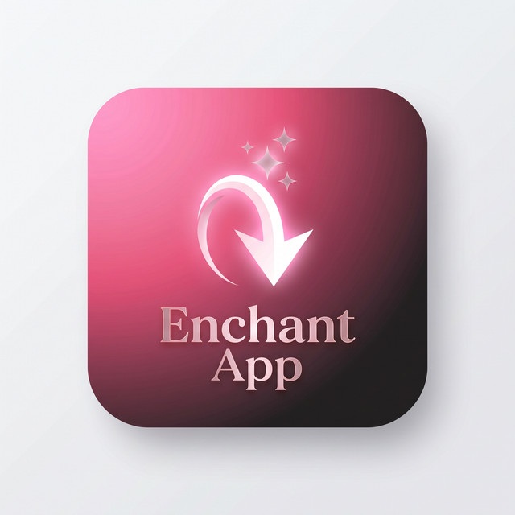

# ✨ Enchant TikTok Downloader (Super HD)

<p align="center">
  
</p>

<p align="center">
  <b>High-Performance TikTok Super HD Video, Slideshow & Audio Downloader (No Watermark)</b><br>
  Equipped with modern Web Interface, REST API & Automated WhatsApp Bot Integration.
</p>

<p align="center">
  <a href="https://tiktok.enchant.id"></a>
  
  
  
</p>

---

## 🌐 Live Preview / Demo

> 🔗 **Website**: [https://tiktok.enchant.id](https://tiktok.enchant.id)  
> 📱 **WhatsApp Bot Pairing**: Tersedia melalui admin dashboard.

---

## 🌟 Fitur Utama

- 🎬 **Super HD Video Download**: Unduh video TikTok tanpa watermark dengan kualitas tertinggi (hingga 1080p/4K jika tersedia di sumber).
- 📸 **Photo / Slideshow Support**: Mendukung unduhan multi-foto TikTok slideshow dalam format ZIP terkompresi secara instan.
- 🎵 **Audio (MP3) Extractor**: Ekstraksi dan streaming audio original secara langsung.
- 💬 **WhatsApp Bot Terintegrasi**: Pengguna cukup kirim link TikTok ke nomor bot WhatsApp, video/audio langsung dikirimkan kembali otomatis.
- 📊 **Live Admin Monitoring**: Dashboard admin dengan statistik realtime CPU, RAM, Disk, uptime server, dan pairing code WhatsApp.
- 📱 **PWA Ready**: Dukungan Progressive Web App (PWA) dengan service worker dan responsif di semua perangkat mobile & desktop.
- ⚡ **Auto Failover Support**: Arsitektur multi-node dengan backup otomatis antara Cloud Server dan Local Server.

---

## 🛠️ Tech Stack

- **Backend**: Node.js, Express.js
- **WhatsApp Integration**: `@innovatorssoft/store-sqlite`, `zapo-js`, `qrcode`
- **Media & Processing**: `axios`, `archiver`, `ws`
- **Frontend**: HTML5, CSS3, Modern Glassmorphism UI, Vanilla JavaScript
- **Process Manager**: PM2

---

## 🚀 Panduan Instalasi & Menjalankan

### 1. Clone Repository
```bash
git clone https://github.com/callmezext/enchant-tiktok-downloader.git
cd enchant-tiktok-downloader
```

### 2. Install Dependencies
```bash
npm install
```

### 3. Konfigurasi (`settings.json`)
Sesuaikan nomor WhatsApp Bot di berkas `settings.json`:
```json
{
  "waBotNumber": "6285713150253"
}
```

### 4. Jalankan Aplikasi
```bash
# Mode Development
node server.js

# Mode Production (PM2)
pm2 start server.js --name enchant-downloader
pm2 save
```

Aplikasi akan berjalan pada port `3300`: [http://localhost:3300](http://localhost:3300).

---

## 📡 Dokumentasi REST API

### 1. Analisis Video TikTok
```http
POST /api/analyze
Content-Type: application/json

{
  "url": "https://vt.tiktok.com/xxxxxx/"
}
```

### 2. Stream / Direct Download
```http
GET /api/stream?url=<ENCODED_VIDEO_URL>&title=<TITLE>
GET /api/download?url=<ENCODED_VIDEO_URL>&filename=<NAME>
```

### 3. Unduh Slideshow Foto (ZIP)
```http
POST /api/download-zip
Content-Type: application/json

{
  "images": ["https://...", "https://..."],
  "title": "tiktok_slideshow"
}
```

### 4. Status Server & Admin
```http
GET /api/admin/bot-status
Headers: x-admin-token: <ADMIN_TOKEN>
```

---

## 📂 Struktur Direktori

```
enchant-tiktok-downloader/
├── public/                 # Static assets & frontend UI
│   ├── index.html          # Web UI utama
│   ├── admin.html          # Dashboard monitoring & WA pairing
│   ├── app.js              # Client logic
│   ├── style.css           # Styling
│   └── sw.js               # Service Worker PWA
├── wa_session/             # Sesi SQLite WhatsApp (di-ignore git)
├── package.json            # Node.js dependencies
├── server.js               # Express server & API routes
├── wa-bot.js               # Engine bot WhatsApp
└── settings.json           # Konfigurasi bot
```

---

## 📄 Lisensi

Project ini dirilis di bawah lisensi **ISC**. Dikembangkan dengan ❤️ oleh **[Callme Zettx](https://github.com/callmezext)**.
